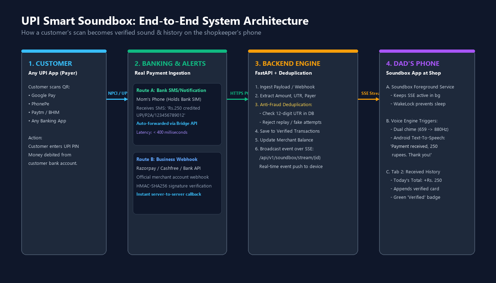
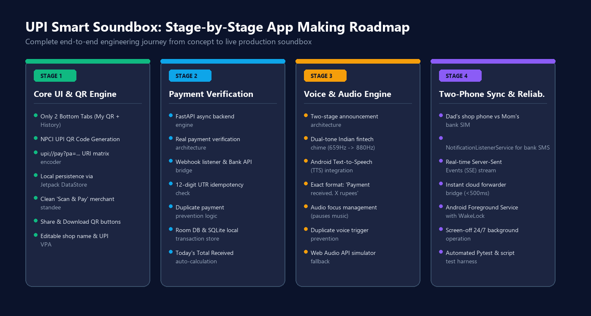
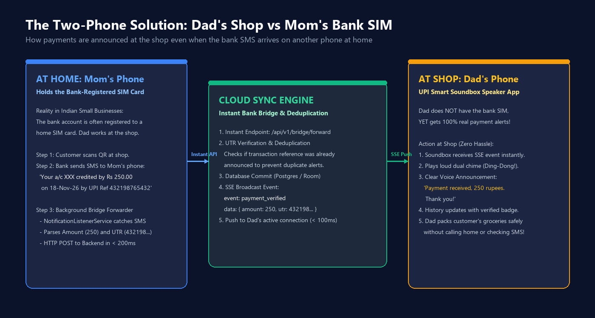
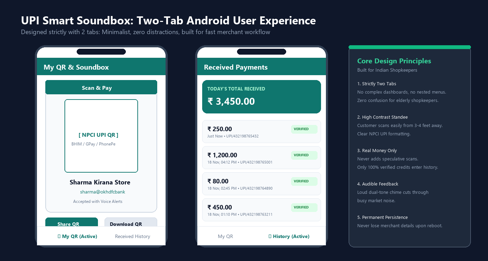
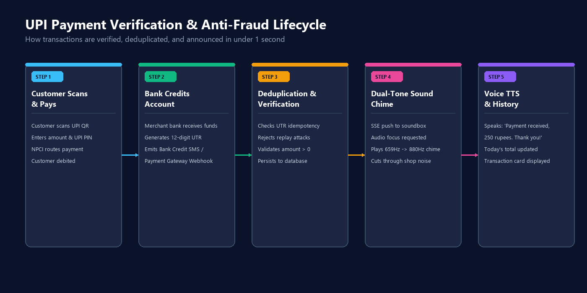

# UPI Smart Soundbox – Android & Backend System

[](https://python.org)
[](https://fastapi.tiangolo.com)
[](https://kotlinlang.org)
[](https://developer.android.com/jetpack/compose)
[]()

A complete, production-grade digital UPI Soundbox solution designed for Indian merchants. Converts an ordinary Android smartphone into an instant, reliable UPI payment soundbox with automated English voice announcements, NPCI UPI QR code generation, real-time background operation, cryptographic payment verification, and a two-phone family bridge.



---

## 📚 Complete Learning & Documentation Series

We have created an in-depth, stage-by-stage learning guide with visual diagrams for developers, students, and shopkeepers:

| Chapter / Stage | Description | Core Topics |
| :--- | :--- | :--- |
| **[00. Overview & Roadmap](learning/00_OVERVIEW_AND_LEARNING_GUIDE.md)** | Master roadmap and concept guide | Problem statement, hardware rental pain points, high-level architecture. |
| **[01. Stage 1: Core UI & QR Engine](learning/01_STAGE_1_CORE_UI_AND_QR_ENGINE.md)** | Minimalist 2-tab Android Compose UI | NPCI QR generation (`upi://pay?pa=...`), Jetpack DataStore, Share/Download standee. |
| **[02. Stage 2: Payment Verification](learning/02_STAGE_2_PAYMENT_VERIFICATION_AND_BACKEND.md)** | FastAPI backend & anti-fraud engine | Why static QRs don't ping phones, 12-digit UTR idempotency check, deduplication. |
| **[03. Stage 3: Voice & Audio Engine](learning/03_STAGE_3_VOICE_ANNOUNCEMENT_AND_AUDIO_ENGINE.md)** | Dual-tone chime & English TTS | Dual-tone synthesis (659Hz $\rightarrow$ 880Hz), "Payment received, X rupees", audio focus ducking. |
| **[04. Stage 4: Two-Phone Sync & Bridge](learning/04_STAGE_4_THE_TWO_PHONE_PROBLEM_AND_BACKGROUND_SYNC.md)** | Dad's shop vs Mom's bank SIM | GPay/PhonePe Cashier mode, NotificationListenerService, SSE stream, 24/7 WakeLock. |
| **[05. How to Run & Test Everything](learning/05_HOW_TO_RUN_AND_TEST_EVERYTHING.md)** | Step-by-step setup & testing | Running FastAPI, Web Simulator, Android Studio APK build, Pytest tests, curl bridge tests. |
| **[06. Key Technologies Walkthrough](learning/06_KEY_TECHNOLOGIES_AND_CODE_WALKTHROUGH.md)** | Code deep dive & architectural patterns | Detailed walkthrough of Compose UI, Room DB, FastAPI async routers, and background services. |

*Additional technical specifications can also be accessed in [`documents/`](documents/README.md) and [`docs/`](docs/ARCHITECTURE.md).*

---

## 🖼️ Visual Architecture & Workflows

| Roadmap & Stages | Two-Phone Family Solution |
| :---: | :---: |
| [](learning/00_OVERVIEW_AND_LEARNING_GUIDE.md) | [](learning/04_STAGE_4_THE_TWO_PHONE_PROBLEM_AND_BACKGROUND_SYNC.md) |
| **Two-Tab Android UX** | **Payment Verification Lifecycle** |
| [](learning/01_STAGE_1_CORE_UI_AND_QR_ENGINE.md) | [](learning/02_STAGE_2_PAYMENT_VERIFICATION_AND_BACKEND.md) |

---

## 💡 Highlights & Features

- **Strict Two-Tab Architecture**:
  - **Tab 1: My QR**: Merchant setup, NPCI QR standee with "Scan & Pay", Share QR, Download QR, and edit mode.
  - **Tab 2: Received History**: Displays "Today's Total Received" and clean feed of verified transactions.
- **NPCI UPI QR Code Generator**: Produces compliant UPI payment QR codes (`upi://pay?pa=...&pn=...&cu=INR`).
- **Cryptographic Payment Detection & Anti-Fraud**:
  - Never marks payments as received just because a QR was scanned.
  - Zero fake receipts: Replay and duplicate attack protection using 12-digit Bank Reference Numbers (UTR/RRN).
- **Automatic Voice Announcements**:
  - Two-stage announcement: Dual-tone chime ($659.25\text{ Hz} \rightarrow 880\text{ Hz}$) followed by:
    *"Payment received, [amount] rupees. Thank you!"*
  - Dual-layer duplicate speech guard (in-memory concurrent cache + Room SQLite check).
  - Audio focus management (automatically ducks or pauses other apps playing audio).
- **The Two-Phone Shopkeeper Solution**:
  - Solves the common Indian family problem where Dad is at the shop and Mom's phone has the bank SIM.
  - Automated SMS/Push Notification forwarder (`POST /api/v1/bridge/forward`) and real-time SSE stream.
- **Background Reliability**:
  - Android Foreground Service with ongoing notification and `PARTIAL_WAKE_LOCK` for screen-off 24/7 operation.
- **Interactive Web Simulator**:
  - Live interactive web simulator at `http://localhost:8000` to test transactions, audio chimes, and voice speech in any browser.

---

## 📂 Project Directory Structure

```text
sound bocx/
├── android/                         # Native Android Studio Project
│   ├── build.gradle.kts             # Gradle build scripts
│   └── app/src/main/
│       ├── AndroidManifest.xml      # Foreground service, WakeLock, NotificationListener
│       └── java/com/upisoundbox/    # Jetpack Compose UI, Room DB, TTS, Services
├── backend/                         # Python FastAPI Backend
│   ├── app/
│   │   ├── main.py                  # FastAPI Entry & Middleware
│   │   ├── database.py              # Async SQLAlchemy Engine
│   │   ├── models.py                # SQL models (Merchants, Transactions)
│   │   ├── routers/                 # API routers (merchants, payments, webhooks, stream, bridge)
│   │   └── static/simulator.html    # Full-featured web soundbox simulator
│   ├── tests/                       # Automated Pytest suite (7 tests)
│   └── run_backend.py               # Launcher script
├── documents/                       # Technical specifications & references
│   ├── ARCHITECTURE.md              # Technical architecture
│   ├── TWO_PHONE_DAD_WORKPLACE_SETUP.md # Family shop setup guide
│   ├── NPCI_UPI_SPECIFICATION.md    # NPCI deep-linking standard
│   └── GATEWAY_INTEGRATION_GUIDE.md # Razorpay & Cashfree onboarding
├── learning/                        # Comprehensive stage-by-stage learning series
│   ├── images/                      # High-res architecture diagrams
│   ├── 00_OVERVIEW_AND_LEARNING_GUIDE.md
│   ├── 01_STAGE_1_CORE_UI_AND_QR_ENGINE.md
│   ├── 02_STAGE_2_PAYMENT_VERIFICATION_AND_BACKEND.md
│   ├── 03_STAGE_3_VOICE_ANNOUNCEMENT_AND_AUDIO_ENGINE.md
│   ├── 04_STAGE_4_THE_TWO_PHONE_PROBLEM_AND_BACKGROUND_SYNC.md
│   ├── 05_HOW_TO_RUN_AND_TEST_EVERYTHING.md
│   ├── 06_KEY_TECHNOLOGIES_AND_CODE_WALKTHROUGH.md
│   └── README.md
└── scripts/
    ├── generate_learning_diagrams.py# Pillow diagram generator
    └── test_soundbox_flow.py        # End-to-end integration test
```

---

## 🚀 Quickstart Guide

### 1. Run the FastAPI Backend & Simulator

```powershell
# Navigate to directory
cd "c:\Users\Dev\Downloads\sound bocx"

# Activate Python environment
.\backend\venv\Scripts\Activate.ps1

# Run tests
.\backend\venv\Scripts\python.exe -m pytest backend/tests -v

# Start the server
python backend/run_backend.py
```

- **Web Simulator**: Open **`http://localhost:8000`** in Chrome/Edge.
- **Interactive Swagger Docs**: Open **`http://localhost:8000/docs`**.

### 2. Run in Android Studio
1. Open the `android/` folder in Android Studio.
2. Build and run on an Android device (API Level 26+).
3. Grant notification listener permission for automatic payment detection.

---

## 🧪 Verification & Security Architecture

1. **Anti-Fraud Idempotency**: Every payment is checked against the database with its 12-digit UTR. Replay attacks and duplicate scans are strictly rejected.
2. **HMAC-SHA256 Signatures**: Gateway webhooks are authenticated with cryptographic HMAC signatures.
3. **Audio Lock**: A thread-safe concurrent registry ensures that the exact same payment amount and UTR will never be announced twice.
