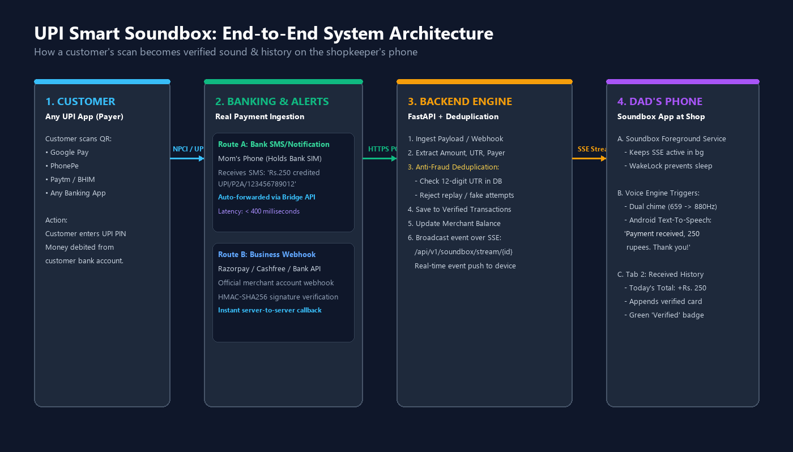
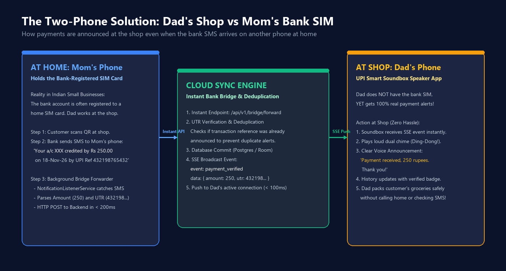
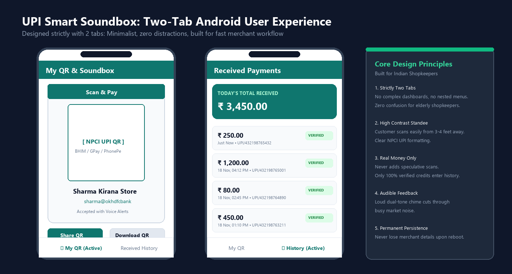
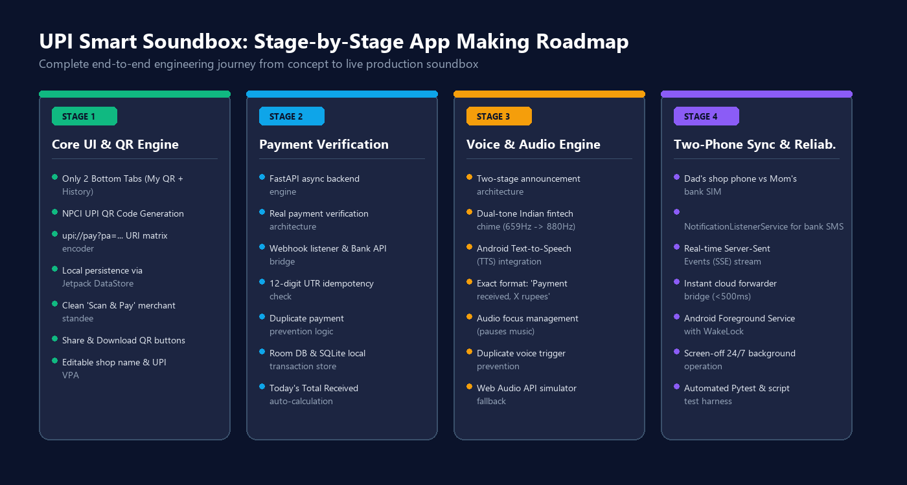
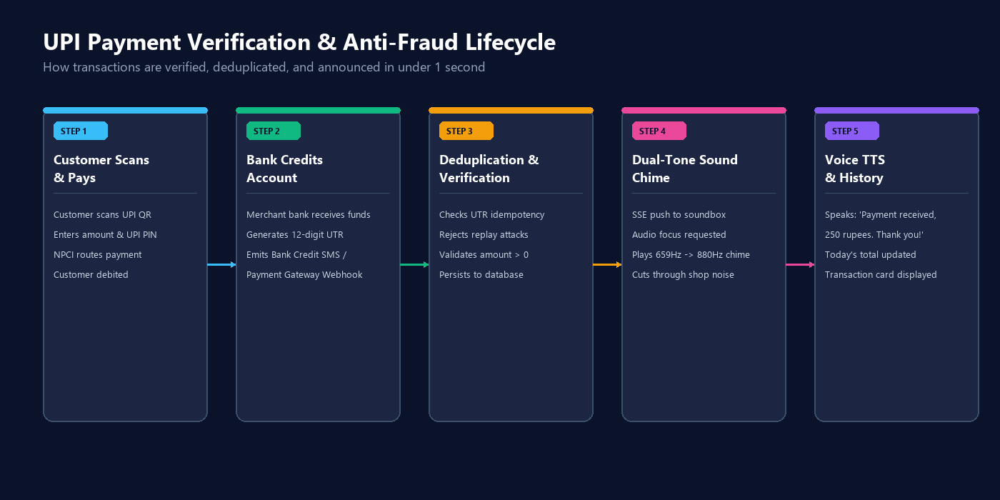

# 📑 UPI Smart Soundbox: Engineering Documents

Welcome to the technical documentation repository for the **UPI Smart Soundbox**.

---

## 🖼️ Architecture & Workflow Diagrams
- **System Architecture**: 
- **The Two-Phone Solution**: 
- **App Screens & UI Layout**: 
- **Stage Roadmap**: 
- **Payment Verification Lifecycle**: 

---

## 📚 Technical Document Directory

| Document | Description |
| :--- | :--- |
| **[ARCHITECTURE.md](ARCHITECTURE.md)** | Comprehensive technical architecture across Android Kotlin/Compose, Room DB, FastAPI backend, and SSE real-time stream. |
| **[VERCEL_DEPLOYMENT_GUIDE.md](VERCEL_DEPLOYMENT_GUIDE.md)** | Guide to deploying on Vercel, solving 500 FUNCTION_INVOCATION_FAILED, and serverless best practices. |
| **[TWO_PHONE_DAD_WORKPLACE_SETUP.md](TWO_PHONE_DAD_WORKPLACE_SETUP.md)** | Step-by-step practical guide solving the setup where Dad is at the shop and Mom's phone holds the bank SIM. |
| **[NPCI_UPI_SPECIFICATION.md](NPCI_UPI_SPECIFICATION.md)** | Complete specification of NPCI UPI payment QR strings (`upi://pay?pa=...`), standard parameters, and checksum rules. |
| **[GATEWAY_INTEGRATION_GUIDE.md](GATEWAY_INTEGRATION_GUIDE.md)** | Guide to onboarding with Indian payment gateways (Razorpay, Cashfree, ICICI Eazypay) for official merchant webhooks. |

---

## 🎓 Stage-by-Stage Learning Course
For step-by-step tutorials explaining the total app-making process and technologies used in stages, visit the **[learning/ directory](../learning/README.md)**.

