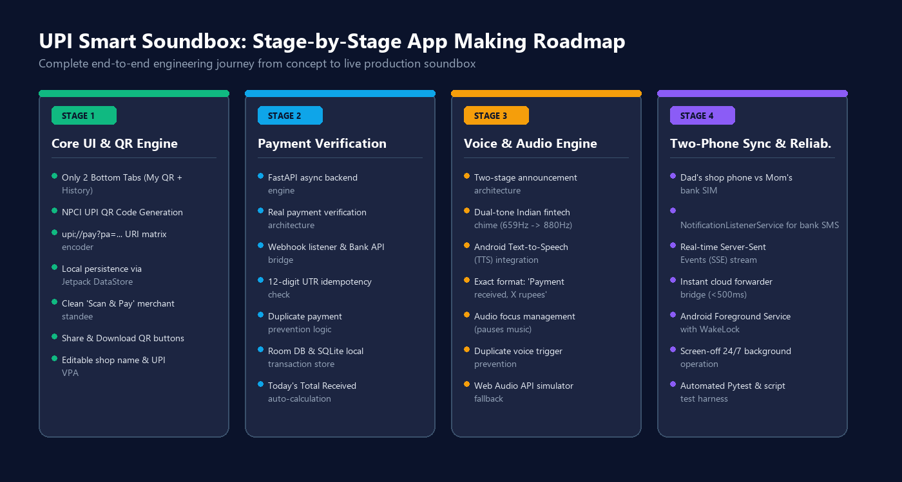
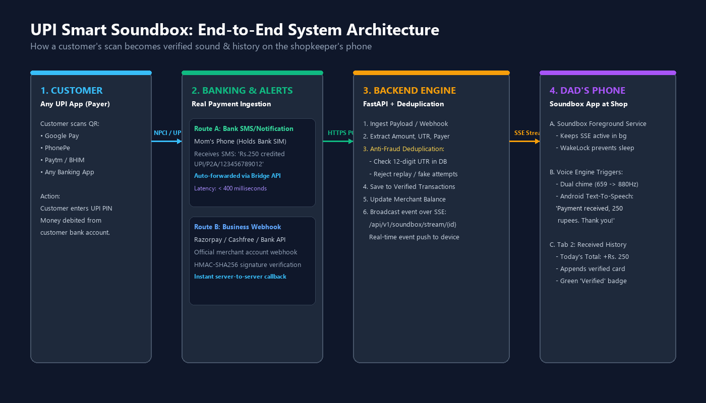

# UPI Smart Soundbox: Learning & Documentation Series

Welcome to the comprehensive, stage-by-stage engineering guide for the **UPI Smart Soundbox**! This documentation covers the entire journey of building a production-grade Android and FastAPI soundbox application from scratch.

---

## 🎯 Master Learning Curriculum

| Stage / Module | Topic | Core Technologies | Key Takeaways |
| :--- | :--- | :--- | :--- |
| **[01. Stage 1: Core UI & QR Engine](01_STAGE_1_CORE_UI_AND_QR_ENGINE.md)** | Two-Tab Architecture & NPCI QR Generation | Kotlin, Jetpack Compose, DataStore, ZXing | Clean 2-tab UX, NPCI UPI URI scheme, vector QR rendering, local merchant storage, share & download standee. |
| **[02. Stage 2: Payment Verification](02_STAGE_2_PAYMENT_VERIFICATION_AND_BACKEND.md)** | FastAPI Backend, Webhooks & Anti-Fraud | Python, FastAPI, SQLAlchemy, SQLite/Postgres | The truth about static QRs, webhook ingestion, 12-digit UTR idempotency check, duplicate transaction prevention. |
| **[03. Stage 3: Voice & Audio Engine](03_STAGE_3_VOICE_ANNOUNCEMENT_AND_AUDIO_ENGINE.md)** | Dual-Tone Chime & Android TTS | Android TTS, Web Audio API, AudioManager | Dual-tone audio synthesis (659Hz $\rightarrow$ 880Hz), "Payment received, X rupees. Thank you!", audio focus ducking. |
| **[04. Stage 4: Two-Phone Sync & Bridge](04_STAGE_4_THE_TWO_PHONE_PROBLEM_AND_BACKGROUND_SYNC.md)** | The Family Shop Dilemma & SSE Streaming | Server-Sent Events (SSE), NotificationListener, ForegroundService | Solving Dad's shop vs Mom's bank SIM problem, automatic SMS forwarder bridge, 24/7 background WakeLock. |
| **[05. How to Run & Test Everything](05_HOW_TO_RUN_AND_TEST_EVERYTHING.md)** | Full Setup, Simulator & Verification | Uvicorn, Android Studio, Pytest, PowerShell | Running FastAPI, using the interactive web simulator, building Android APK, automated end-to-end tests. |
| **[06. Technologies & Code Walkthrough](06_KEY_TECHNOLOGIES_AND_CODE_WALKTHROUGH.md)** | Code Deep Dive & Design Patterns | Full Stack Architecture | Line-by-line review of Compose UI, Room DB, FastAPI routers, SSE broadcaster, and bridge APIs. |

---

## 💡 What is the Problem We Are Solving?

In India, millions of local shopkeepers (*kirana stores, chai stalls, street vendors*) rely on physical hardware soundboxes provided by Paytm, PhonePe, or Google Pay.

However, physical soundbox devices have serious drawbacks:
1. **Recurring Monthly Rental Fees**: Merchants pay **₹125 to ₹150 every month** perpetually. Over 3 years, that is more than ₹5,000 for a plastic speaker!
2. **Deposit & Replacement Cost**: Damaged hardware or battery degradation requires service center visits.
3. **The Two-Phone Dilemma**: Often, the registered bank SIM card is in a phone at home (*e.g., Mom's phone*), while the shopkeeper (*e.g., Dad*) works at the stall. When a customer scans a static QR, Dad receives no bank SMS, causing awkward arguments or payment fraud.

### The Solution:
**UPI Smart Soundbox** turns **any regular Android smartphone into a high-grade, zero-cost, intelligent soundbox** that:
- Generates NPCI-compliant payment QR standees instantly.
- Announces real, verified payments with a loud Indian fintech chime and clear English voice.
- Completely prevents duplicate or fake transaction announcements.
- Solves the two-phone problem using a real-time cloud bridge and SMS notification listener.

---

## 🗺️ High-Level System Architecture

Continue your learning by reading **[Stage 1: Core UI & QR Engine](01_STAGE_1_CORE_UI_AND_QR_ENGINE.md)**!
