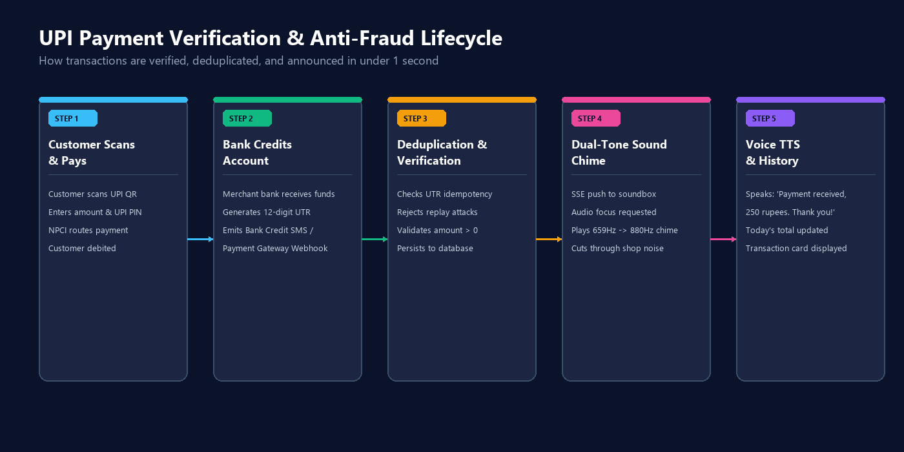

# Stage 2: Payment Verification & Backend Engine

In Stage 2, we built the verification and security engine. We tackled the single most misunderstood concept in UPI app development: **how to detect that a customer actually paid real money without assuming or faking it**.



---

## ⚠️ The Critical Truth About Static UPI QR Codes

Many novice developers assume:
> *"If I generate a QR code for my UPI ID and a customer scans it, my app will automatically know!"*

**This is 100% false.**
- A standard static UPI QR code (`upi://pay?pa=sharma@okhdfcbank...`) is merely an offline instruction string for the customer's payment app.
- When the customer scans it with Google Pay or PhonePe, their phone talks directly to the **National Payments Corporation of India (NPCI)** and their bank.
- **Your phone is NOT involved in the scan.** Your phone receives no HTTP request, no Bluetooth signal, and no internet packet simply because someone scanned the QR.
- The **ONLY** time your merchant account knows money arrived is when the **merchant's bank credits the account** and emits a confirmation alert:
  1. **Bank Credit SMS / Notification** sent to the registered mobile SIM.
  2. **Payment Gateway Webhook** sent to a secure backend server.

---

## 🛡️ Anti-Fraud Principle: No Fake Payments!

To protect shopkeepers from scammers who show fake screenshot apps:
1. **Never mark a payment as received on QR scan.**
2. **Never mark a payment as received on customer button click.**
3. **Only trigger history and voice alerts when a 100% verified bank credit event is authenticated.**

---

## ⚡ FastAPI Verification Backend Architecture

We developed an asynchronous FastAPI backend engine in Python with SQLAlchemy and Pydantic v2:

```text
backend/
├── app/
│   ├── main.py                  # FastAPI Application Entry & Middleware
│   ├── config.py                # Environment configuration & secrets
│   ├── database.py              # Async SQLAlchemy Engine & Session
│   ├── models.py                # Merchant & Transaction SQL Models
│   ├── schemas.py               # Pydantic Request & Response Schemas
│   ├── security.py              # HMAC-SHA256 signature verification
│   ├── routers/
│   │   ├── merchants.py         # Merchant registration & profile
│   │   ├── payments.py          # Payment verification & manual check
│   │   ├── webhooks.py          # Gateway webhook ingestion
│   │   ├── soundbox_stream.py   # Real-time SSE event broadcast
│   │   └── bridge.py            # Bank SMS / Notification forwarder
│   └── services/
│       ├── payment_service.py   # Core transaction idempotency logic
│       └── providers/           # Sandbox & Razorpay integrations
```

---

## 🔑 12-Digit UTR & Idempotency Check

In India's UPI ecosystem, every single transaction is assigned a globally unique **12-digit UTR** (*Unique Transaction Reference*), also known as the Bank RRN (*Retrieval Reference Number*).

### The Idempotency Algorithm:
When a payment webhook or SMS notification arrives at the backend:
1. Extract the 12-digit UTR (`bank_ref`).
2. Query the database table `transactions` where `bank_ref == incoming_utr`.
3. If an entry already exists with `status == "SUCCESS"`:
   - **Reject duplicate execution**.
   - Return HTTP `200 OK` (idempotent acknowledge) without re-broadcasting voice alerts or double-counting money in Today's Total.
4. If it is a new UTR:
   - Insert new `Transaction` record into SQLite / PostgreSQL.
   - Increment merchant's `today_total`.
   - Broadcast live event to the Android soundbox app.

```python
# backend/app/services/payment_service.py
async def record_verified_payment(
    db: AsyncSession,
    merchant_id: str,
    amount: float,
    bank_ref: str,
    payer_name: Optional[str] = None
) -> Tuple[Transaction, bool]:
    # 1. Anti-Fraud Deduplication Check
    query = select(Transaction).where(Transaction.bank_ref == bank_ref)
    result = await db.execute(query)
    existing = result.scalar_one_or_none()

    if existing:
        # Already processed! Prevent duplicate sound and double counting
        return existing, False

    # 2. Record new verified credit
    tx = Transaction(
        id=str(uuid.uuid4()),
        merchant_id=merchant_id,
        amount=amount,
        bank_ref=bank_ref,
        payer_name=payer_name or "UPI Customer",
        status="SUCCESS",
        verified_at=datetime.utcnow()
    )
    db.add(tx)
    await db.commit()
    await db.refresh(tx)
    return tx, True
```

---

## 🔒 HMAC-SHA256 Webhook Signature Verification

When connecting an official payment provider (*Razorpay, Cashfree, or ICICI Eazypay*), webhooks are signed using HMAC-SHA256 to ensure that hackers cannot inject fake payment notifications into the server:

```python
# backend/app/security.py
def verify_webhook_signature(payload_bytes: bytes, signature_header: str, secret: str) -> bool:
    expected_signature = hmac.new(
        secret.encode("utf-8"),
        payload_bytes,
        hashlib.sha256
    ).hexdigest()
    return hmac.compare_digest(expected_signature, signature_header)
```

---

## 📱 Tab 2: Received History (Android Compose)

The Received History screen displays:
1. **Today's Total Received (₹)**: Large emerald hero card calculating verified payments received today.
2. **Verified Payment Feed**:
   - Received amount in bold (`₹ 250.00`).
   - Relative timestamp (`Just Now`, `18 Nov, 04:12 PM`).
   - 12-digit UTR reference (`UPI/432198765432`).
   - Green pill badge (`VERIFIED`).

### Local Room Database:
```kotlin
@Entity(tableName = "transactions")
data class TransactionEntity(
    @PrimaryKey val id: String,
    val amount: Double,
    val bankRef: String,
    val payerName: String,
    val timestamp: Long,
    val status: String = "VERIFIED"
)

@Dao
interface TransactionDao {
    @Query("SELECT * FROM transactions ORDER BY timestamp DESC")
    fun getAllTransactions(): Flow<List<TransactionEntity>>

    @Query("SELECT SUM(amount) FROM transactions WHERE timestamp >= :startOfDay")
    fun getTodayTotal(startOfDay: Long): Flow<Double?>

    @Insert(onConflict = OnConflictStrategy.IGNORE)
    suspend fun insertTransaction(tx: TransactionEntity): Long
}
```

---

### Next Step:
Now that transactions are verified and saved without duplicates, continue to **[Stage 3: Voice Announcement & Audio Engine](03_STAGE_3_VOICE_ANNOUNCEMENT_AND_AUDIO_ENGINE.md)** to learn how the dual-tone chime and voice alerts are produced!

