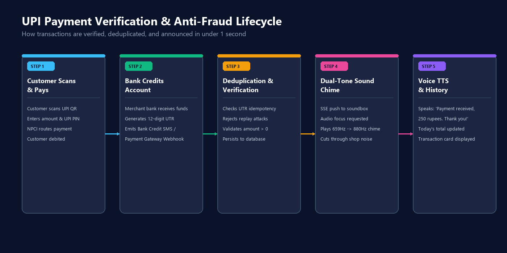
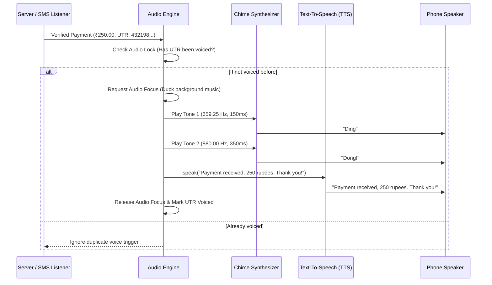

# Stage 3: Voice Announcement & Audio Engine

In Stage 3, we built the voice and sound engine that turns an Android phone into a true "Smart Soundbox". When money is credited, the app plays an unmistakable Indian fintech chime followed immediately by a crisp voice announcement.



---

## 🔊 The Psychology of Soundboxes in India

In busy Indian bazaars:
- Shopkeepers are busy cutting vegetables, packaging dry goods, or serving hot chai.
- They cannot stop work every 30 seconds to wipe dirty hands and unlock a smartphone screen to verify an SMS.
- Scammers exploit this by showing fake payment apps that mimic the Google Pay "tick" screen.
- **The Voice Soundbox solved this problem permanently**: The speaker announces the exact amount out loud for everyone in the shop to hear. The sound gives 100% confidence to the merchant and honesty to the customer.

---

## 🎵 The Two-Stage Audio Sequence

A professional soundbox does not just speak plain speech. It uses a **two-stage audio design**:



---

## 🎼 1. The Dual-Tone Chime Synthesis

Rather than relying on heavy `.mp3` audio files that might fail to load from disk, we synthesize the chime frequencies directly or play clean frequency tones:

- **Tone 1 (E5)**: Frequency = $659.25\text{ Hz}$, duration = $150\text{ ms}$.
- **Tone 2 (A5)**: Frequency = $880.00\text{ Hz}$, duration = $350\text{ ms}$ with exponential decay.

### Web Audio API Synthesis (Web Simulator):
```javascript
function playFintechChime(audioCtx) {
    const now = audioCtx.currentTime;
    
    // Tone 1: E5 (659.25 Hz)
    const osc1 = audioCtx.createOscillator();
    const gain1 = audioCtx.createGain();
    osc1.type = "sine";
    osc1.frequency.setValueAtTime(659.25, now);
    gain1.gain.setValueAtTime(0.7, now);
    gain1.gain.exponentialRampToValueAtTime(0.01, now + 0.15);
    osc1.connect(gain1);
    gain1.connect(audioCtx.destination);
    osc1.start(now);
    osc1.stop(now + 0.15);

    // Tone 2: A5 (880.00 Hz) - starts at 150ms
    const osc2 = audioCtx.createOscillator();
    const gain2 = audioCtx.createGain();
    osc2.type = "sine";
    osc2.frequency.setValueAtTime(880.00, now + 0.15);
    gain2.gain.setValueAtTime(0.8, now + 0.15);
    gain2.gain.exponentialRampToValueAtTime(0.001, now + 0.55);
    osc2.connect(gain2);
    gain2.connect(audioCtx.destination);
    osc2.start(now + 0.15);
    osc2.stop(now + 0.55);
}
```

---

## 🗣️ 2. Android Text-to-Speech (TTS) Engine

We built `TextToSpeechManager.kt` using the native Android `android.speech.tts.TextToSpeech` API:

### Exact Announcement Format:
```text
"Payment received, [amount] rupees. Thank you!"
```
*Example*: For ₹250 $\rightarrow$ `"Payment received, 250 rupees. Thank you!"`  
*Example*: For ₹1,200 $\rightarrow$ `"Payment received, 1200 rupees. Thank you!"`

```kotlin
// android/app/src/main/java/com/upisoundbox/service/TextToSpeechManager.kt
class TextToSpeechManager(private val context: Context) : TextToSpeech.OnInitListener {
    private var tts: TextToSpeech? = TextToSpeech(context, this)
    private var isInitialized = false

    override fun onInit(status: Int) {
        if (status == TextToSpeech.SUCCESS) {
            tts?.let { engine ->
                // Prefer Indian English (en-IN) for natural Indian rupee pronunciation
                val locale = Locale("en", "IN")
                val result = engine.setLanguage(locale)
                if (result == TextToSpeech.LANG_MISSING_DATA || result == TextToSpeech.LANG_NOT_SUPPORTED) {
                    engine.language = Locale.ENGLISH
                }
                engine.setPitch(1.05f)     // Slightly elevated pitch for clarity
                engine.setSpeechRate(0.95f) // Clear, measured pace
                isInitialized = true
            }
        }
    }

    fun announcePayment(amount: Double, onComplete: (() -> Unit)? = null) {
        val formattedAmount = if (amount % 1.0 == 0.0) {
            amount.toInt().toString()
        } else {
            "%.2f".format(amount)
        }
        val text = "Payment received, $formattedAmount rupees. Thank you!"
        
        val params = Bundle().apply {
            putInt(TextToSpeech.Engine.KEY_PARAM_STREAM, AudioManager.STREAM_MUSIC)
        }
        
        tts?.speak(text, TextToSpeech.QUEUE_FLUSH, params, "PAYMENT_ANNOUNCE")
    }
}
```

---

## 🎧 3. Audio Focus & Loudness Management

In a busy store, the shopkeeper might be listening to devotional music or a cricket commentary. If a payment arrives, the soundbox must **duck** (lower) or **pause** the background music, play the announcement at high volume, and then restore music:

```kotlin
val audioManager = context.getSystemService(Context.AUDIO_SERVICE) as AudioManager
val focusRequest = AudioFocusRequest.Builder(AudioManager.AUDIOFOCUS_GAIN_TRANSIENT_MAY_DUCK)
    .setAudioAttributes(
        AudioAttributes.Builder()
            .setUsage(AudioAttributes.USAGE_NOTIFICATION_EVENT)
            .setContentType(AudioAttributes.CONTENT_TYPE_SPEECH)
            .build()
    )
    .setOnAudioFocusChangeListener { focusChange ->
        // Handle focus loss/gain
    }
    .build()

audioManager.requestAudioFocus(focusRequest)
// Play chime and TTS
audioManager.abandonAudioFocusRequest(focusRequest)
```

---

## 🚫 4. Anti-Duplicate Audio Lock

Network retries or re-sent SMS messages must never trigger the voice announcement twice for the same transaction:

```kotlin
object AudioAnnouncementRegistry {
    private val announcedUtrs = Collections.synchronizedSet(mutableSetOf<String>())

    fun shouldAnnounce(utr: String): Boolean {
        synchronized(announcedUtrs) {
            if (announcedUtrs.contains(utr)) {
                return false // Already announced! Block duplicate voice
            }
            announcedUtrs.add(utr)
            return true
        }
    }
}
```

---

### Next Step:
Now that the soundbox speaks verified payments, continue to **[Stage 4: The Two-Phone Problem & Background Sync](04_STAGE_4_THE_TWO_PHONE_PROBLEM_AND_BACKGROUND_SYNC.md)** to see how we solved the real-world family shop setup!
