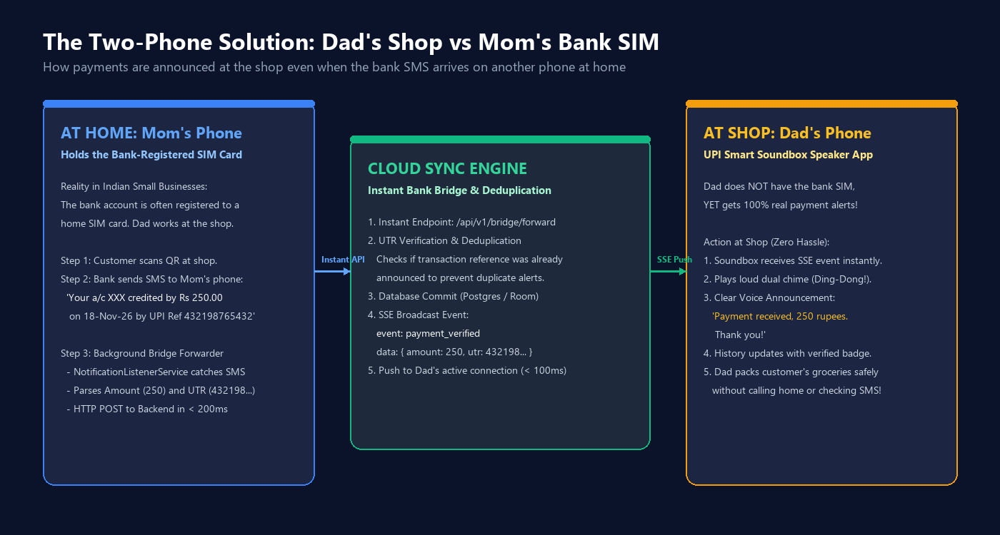
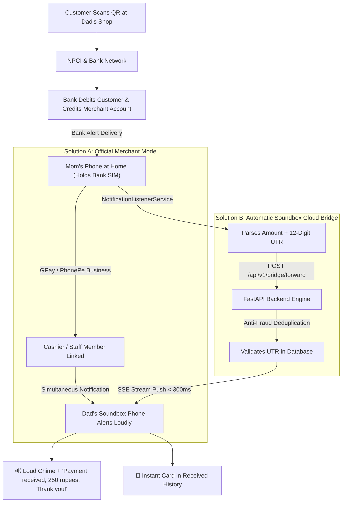

# Stage 4: The Two-Phone Problem & Background Sync

In Stage 4, we tackled the real-world operational reality of Indian family businesses: **the registered bank SIM card is in one phone at home (e.g., Mom's phone), while the shopkeeper (e.g., Dad) is working at the shop without the bank SIM.**



---

## 👨‍👩‍👦 The Real-World Family Shop Problem

In thousands of small grocery and retail shops across India:
1. The family bank account is linked to the primary household mobile number.
2. The SIM card stays at home with the wife / mother.
3. The father or son runs the market stall using their personal phone.
4. **The Friction**:
   - Customer scans the shop's QR code.
   - Bank sends an SMS: *"Your a/c XXX credited with Rs. 250 by UPI ref 432198765432"*.
   - **This SMS arrives at home on Mom's phone!**
   - Dad at the stall gets **zero notification**.
   - Dad either has to call home ("*Did you get 250?*") or awkwardly ask the customer to show their screen, risking fake payment screenshots.

---

## 🛠️ The Two Practical Solutions

We designed two complementary solutions to solve this completely:



---

## 📲 Solution A: Google Pay / PhonePe Business "Staff Role" (Zero Code)

If the merchant uses an official **Google Pay for Business** or **PhonePe Business** account:
1. Open Google Pay Business on Mom's phone (which has the bank SIM).
2. Go to **Settings $\rightarrow$ Manage Staff $\rightarrow$ Add Staff / Cashier**.
3. Enter Dad's phone number and designate him as **"Cashier"**.
4. Now, whenever any customer pays the QR code:
   - Google Pay / PhonePe sends the payment alert to **BOTH Mom's phone and Dad's phone at the exact same second**!
   - Dad's soundbox app intercepts the notification and plays the sound instantly.

---

## 🌉 Solution B: UPI Notification Listener & Cloud Bridge Engine

For merchants using regular savings accounts or personal VPAs, we engineered the **Cloud Bridge**:

### 1. `UPIPaymentNotificationListenerService.kt` (Mom's Phone)
Android provides a powerful system API: `NotificationListenerService`. With explicit user permission (`Settings > Special App Access > Notification Access`), the app intercepts incoming credit SMS and bank notifications in real-time.

#### Intercepted Package Identifiers:
- Google Pay: `com.google.android.apps.nbu.paisa.user`
- PhonePe: `com.phonepe.app`
- Paytm: `net.one97.paytm`
- SMS Messaging: `com.google.android.apps.messaging`, `com.android.mms`
- Bank Apps: HDFC (`com.snapwork.hdfc`), SBI (`com.sbi.lotusintouch`), ICICI (`com.csam.icici.bank.imobile`), Axis (`com.axis.mobile`).

#### Bank Text Parsing Regex:
```kotlin
val amountPattern = Regex(
    pattern = """(?:credited by|received|deposited|paid|credit of).*?(?:Rs\.?|INR|₹)\s*([\d,]+(?:\.\d{1,2})?)""",
    option = RegexOption.IGNORE_CASE
)
val utrPattern = Regex(
    pattern = """\b\d{12}\b""" // Exact 12-digit UPI reference number
)
```

#### Forwarding to Cloud Bridge (`POST /api/v1/bridge/forward`):
When a credit notification is captured, Mom's phone forwards the payload to the server in under 200ms:
```kotlin
val payload = JSONObject().apply {
    put("merchant_id", merchantId)
    put("amount", amount)
    put("bank_ref", utr)
    put("source", "SMS_FORWARDER")
    put("timestamp", System.currentTimeMillis())
}
httpClient.post("https://api.yourdomain.com/api/v1/bridge/forward", payload)
```

---

## 📡 Real-Time Server-Sent Events (SSE) Stream

Why did we use **Server-Sent Events (SSE)** instead of WebSockets?

| Metric | Server-Sent Events (SSE) | WebSockets |
| :--- | :--- | :--- |
| **Protocol** | Standard HTTP/1.1 or HTTP/2 | Custom WS / WSS protocol |
| **Direction** | Server-to-Client push (unidirectional) | Full bidirectional |
| **Reconnection** | Native auto-reconnect built into HTTP | Manual ping-pong & reconnect logic |
| **Battery Life** | Exceptionally low battery consumption | High keepalive battery drain |
| **Firewall friendly** | Traverses standard port 80/443 proxies | Often blocked on mobile carrier APNs |

### FastAPI SSE Endpoint:
```python
# backend/app/routers/soundbox_stream.py
@router.get("/stream/{merchant_id}")
async def stream_soundbox_events(merchant_id: str, request: Request):
    async def event_generator():
        queue = asyncio.Queue()
        await register_soundbox_client(merchant_id, queue)
        try:
            while True:
                if await request.is_disconnected():
                    break
                event_data = await queue.get()
                yield {
                    "event": "payment_verified",
                    "data": json.dumps(event_data)
                }
        finally:
            await unregister_soundbox_client(merchant_id, queue)

    return EventSourceResponse(event_generator())
```

---

## 🔋 24/7 Background Reliability: Foreground Service + WakeLock

Android aggressively kills background apps to conserve battery. To ensure Dad's soundbox never misses a payment even when the screen is locked inside his apron pocket:

1. **`SoundboxForegroundService`**: Runs with `android:foregroundServiceType="connectedDevice"`.
2. **Persistent Ongoing Notification**:
   - Title: `"UPI Smart Soundbox Active"`
   - Subtitle: `"Listening for verified payments..."`
   - Icon: Green speaker badge.
3. **Partial WakeLock**:
   ```kotlin
   val powerManager = getSystemService(Context.POWER_SERVICE) as PowerManager
   val wakeLock = powerManager.newWakeLock(
       PowerManager.PARTIAL_WAKE_LOCK,
       "UPISoundbox::AudioWakeLock"
   )
   wakeLock.acquire(10 * 60 * 1000L /* 10 minutes timeout */)
   ```
4. **Battery Optimization Whitelist**:
   - Prompts the user with `Settings.ACTION_REQUEST_IGNORE_BATTERY_OPTIMIZATIONS` so Android Doze mode does not throttle background network sockets.

---

### Next Step:
Now that you understand the entire 4-stage engineering system, proceed to **[How to Run & Test Everything](05_HOW_TO_RUN_AND_TEST_EVERYTHING.md)**!
